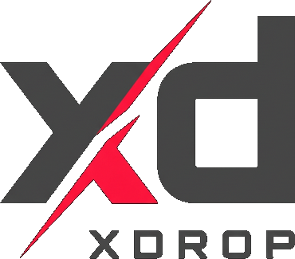
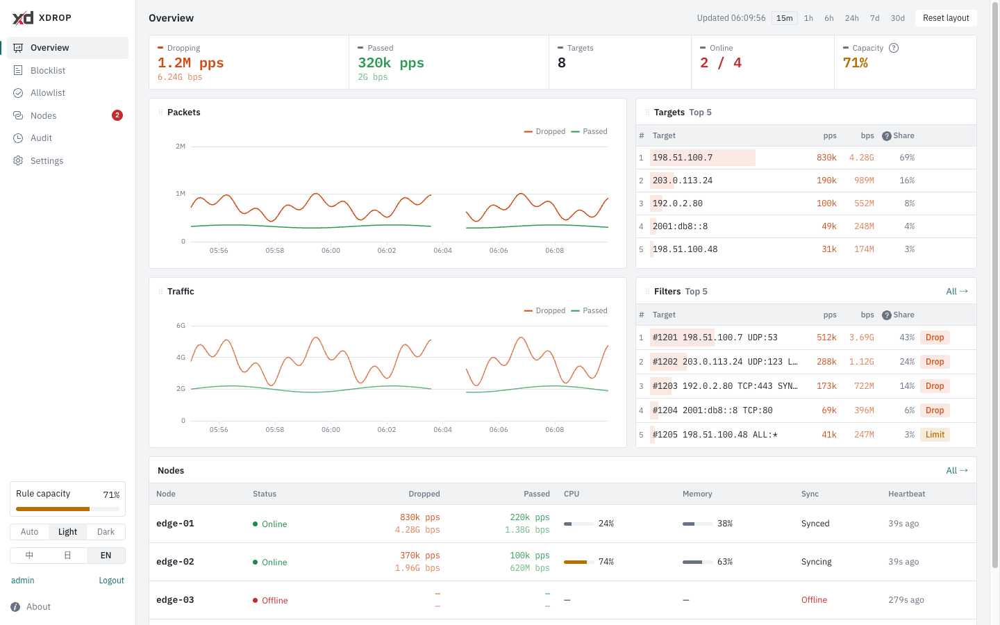
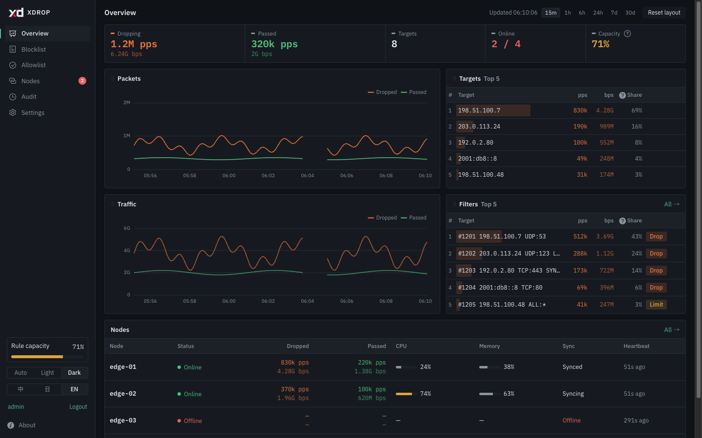

  

  <h1>XDrop</h1>

  
Distributed XDP/eBPF firewall with wire-speed packet filtering and a central management controller.

  
  
  
  

  [中文文档](README.zh.md)

---

## Overview

XDrop combines Linux XDP packet filtering nodes with a central controller and browser console. The controller stores desired rules in SQLite and pushes updates to registered nodes; the node owns BPF loading and packet processing.

Traditional mode passes accepted traffic to the host network stack. Fast Forward mode redirects traffic between one pair of interfaces.

## Features

- IPv4/IPv6 exact-address and prefix rules, transport ports, protocol and packet conditions; actions are `drop` and `rate_limit`.
- Exact five-tuple whitelist and separate atomic rules/whitelist publication.
- Browser sessions with administrator/operator roles, machine credentials, audit records and traffic history.
- Node status, per-rule delivery results and capacity reporting; an API write acknowledges storage before node delivery finishes.

## Screenshot

  
  

Console overview with sample data, light and dark themes.

## Repository layout

| Path | Purpose |
|---|---|
| `controller/cmd/xdrop-controller/` | Controller executable entry |
| `controller/core/` | Storage, authentication, API, orchestration and embedded web UI |
| `console/` | Vue console; builds into `controller/core/webui/build/` |
| `node/agent/` | Go node agent |
| `node/bpf/` | Main and whitelist-gate BPF programs |
| `scripts/build-*.sh`, `scripts/manage-*.sh` | Compilation and process management |

## Requirements

- Node: Linux kernel ≥ 6.4 on little-endian x86-64 or arm64, root access, and a suitable network interface; the BPF code uses iterator kfuncs.
- Check kernel version and JIT separately: `uname -rm`; `sysctl net.core.bpf_jit_enable` must report non-zero (1 enables JIT; 2 also enables JIT debug output).
- Distro coverage (examples): Debian 13 (6.12), Ubuntu 24.04 (6.8), Ubuntu 22.04 HWE (6.5+), RHEL / Rocky / Alma 10 (6.12). Kernels below 6.4 are not supported by this release; earlier v2 releases remain available as tags but are no longer maintained.
- Build tools: Go supporting the module declarations (controller `go 1.21`; node `go 1.24.0`, toolchain `go1.24.4`), a C compiler for controller SQLite, Node.js/npm for the console, and Linux clang with BPF target, make and Python 3 for node BPF.

## Quick start

From the repository root, build the controller with `./scripts/build-controller.sh all`; build a Linux node with `./scripts/build-node.sh all`.

Follow [Getting started](GETTING_STARTED.md) to configure paths, initialize the master key, add an administrator, register a node and verify the first rule. Start and stop with `scripts/manage-controller.sh` and `scripts/manage-node.sh` after initialization.

## Documentation

| Guide | Content |
|---|---|
| [Getting started](GETTING_STARTED.md) | First deployment and rule |
| [Controller](controller/README.md) | Configuration, CLI and operations |
| [Controller API](controller/API.md) | All controller routes and authentication |
| [Node](node/README.md) | Build, operating modes and troubleshooting |
| [Node API](node/API.md) | All node routes and synchronization |

## License

MIT — see [LICENSE](LICENSE).

BPF/C kernel programs (`node/bpf/`) are licensed under GPL-2.0 as required by the Linux kernel BPF subsystem.

---

## Sponsors

<a href="https://www.hytron.io/">
<picture>
  <source media="(prefers-color-scheme: dark)" srcset=".github/assets/sponsor-hytron-dark.png">
  
</picture>
</a>
&nbsp;&nbsp;&nbsp;&nbsp;
<a href="https://www.yecaoyun.com/">
<picture>
  <source media="(prefers-color-scheme: dark)" srcset=".github/assets/sponsor-yecaoyun-dark.png">
  
</picture>
</a>

---

Built entirely with <a href="https://claude.com/product/claude-code">Claude Code</a> — including the XDP/BPF kernel program, Go concurrency, and Vue frontend.
