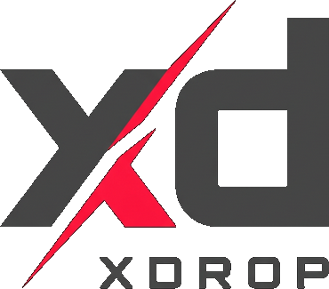
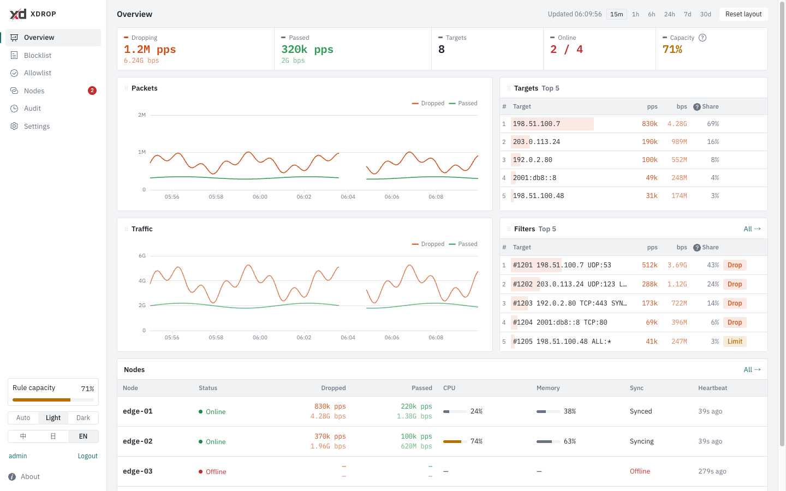
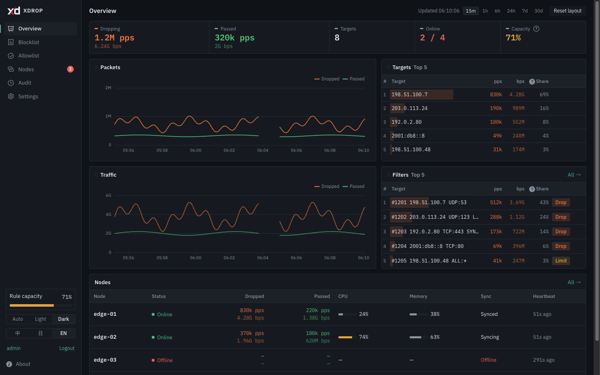

  

  <h1>XDrop</h1>

  
基于 XDP/eBPF 的分布式防火墙，支持线速包过滤与集中管控。

  
  
  
  

  [在线演示（示例数据）](https://littlewolf9527.github.io/xdrop/)
  [English](README.md)

---

## 项目简介

XDrop 将 Linux XDP 过滤节点、集中控制器和浏览器控制台组合起来。控制器在 SQLite 中保存期望规则并向已登记节点推送更新；节点负责 BPF 加载和报文处理。

传统模式将放行流量交给主机协议栈；Fast Forward 模式在一对接口之间重定向流量。

## 功能

- 支持 IPv4/IPv6 精确地址和前缀规则、传输层端口、协议与报文条件；动作为 `drop` 和 `rate_limit`。
- 支持精确五元组白名单，规则与白名单分别原子发布。
- 提供管理员/操作员浏览器会话、机器凭证、审计记录和流量历史。
- 提供节点状态、逐规则下发结果和容量报告；API 写入先确认存储，节点下发随后完成。

## 界面截图

  
  

控制台总览页（示例数据），浅色与深色主题。

## 仓库结构

| 路径 | 用途 |
|---|---|
| `controller/cmd/xdrop-controller/` | 控制器可执行文件入口 |
| `controller/core/` | 存储、鉴权、API、编排及嵌入式前端 |
| `console/` | Vue 控制台；输出到 `controller/core/webui/build/` |
| `node/agent/` | Go 节点 agent |
| `node/bpf/` | 主过滤与白名单入口 BPF 程序 |
| `scripts/build-*.sh`, `scripts/manage-*.sh` | 编译与进程管理 |

## 环境要求

- 节点：小端 x86-64 或 arm64，Linux 内核 ≥ 6.4，root 权限及适合的网卡；BPF 代码使用迭代器 kfunc。
- 内核版本与 JIT 分别查：`uname -rm`；`sysctl net.core.bpf_jit_enable` 必须为非零（1 开启 JIT；2 还开启 JIT 调试输出）。
- 发行版举例：Debian 13（6.12）、Ubuntu 24.04（6.8）、Ubuntu 22.04 HWE（6.5+）、RHEL / Rocky / Alma 10（6.12）。本版本不支持 6.4 以下的内核；更早的 v2 版本仍以标签形式保留，但不再维护。
- 构建工具：满足模块声明的 Go（控制器 `go 1.21`；节点 `go 1.24.0`、工具链 `go1.24.4`）、用于控制器 SQLite 的 C 编译器、用于控制台的 Node.js/npm，以及节点 BPF 所需的 Linux BPF target clang、make 和 Python 3。

## 快速开始

在仓库根目录运行 `./scripts/build-controller.sh all` 构建控制器；在 Linux 节点运行 `./scripts/build-node.sh all`。

按[部署指南](GETTING_STARTED.zh.md)设置路径、初始化主密钥、添加管理员、登记节点并验证第一条规则。初始化完成后使用 `scripts/manage-controller.sh` 和 `scripts/manage-node.sh` 启停。

## 文档索引

| 指南 | 内容 |
|---|---|
| [部署指南](GETTING_STARTED.zh.md) | 首次部署与规则验证 |
| [控制器](controller/README.zh.md) | 配置、CLI 与运维 |
| [控制器 API](controller/API.zh.md) | 全部控制器路由及鉴权 |
| [节点](node/README.zh.md) | 构建、运行模式与排障 |
| [节点 API](node/API.zh.md) | 全部节点路由及同步 |

## 许可证

MIT — 详见 [LICENSE](LICENSE)。

BPF/C 内核程序（`node/bpf/`）遵循 GPL-2.0 协议，这是 Linux 内核 BPF 子系统的要求。

---

## 赞助商

<a href="https://www.hytron.io/">
<picture>
  <source media="(prefers-color-scheme: dark)" srcset=".github/assets/sponsor-hytron-dark.png">
  
</picture>
</a>
&nbsp;&nbsp;&nbsp;&nbsp;
<a href="https://www.yecaoyun.com/">
<picture>
  <source media="(prefers-color-scheme: dark)" srcset=".github/assets/sponsor-yecaoyun-dark.png">
  
</picture>
</a>

---

本项目完全通过 <a href="https://claude.com/product/claude-code">Claude Code</a> vibe coding 构建——包括 XDP/BPF 内核程序、Go 并发调度和 Vue 前端。
